# KernelExtensions

[](https://github.com/LDTchara/KernelExtensions/releases)
[](https://github.com/LDTchara/KernelExtensions/actions/workflows/nightly.yml)

> **KernelExtensions** 是一个面向 Hacknet 扩展作者的"开箱即用"组件库：把原版风格的完整系统（自定义试炼、场景切换、飞机、心脏结局、定时器、本地化、动态颜色……）封装为 **XML 可配置**的组件，扩展作者无需编写 C# 即可搭建复杂剧情。基于 Pathfinder API 深度集成（Harmony 补丁、存档钩子、多语言）。  
> **KernelExtensions** is a drop-in component library for Hacknet extension authors: complete vanilla-styled systems (custom trials, scene switching, aircraft, heart finale, timers, localisation, dynamic colors, ...) packaged as **XML-configurable** components, so you can build rich storylines without writing C#. Deeply integrated with the Pathfinder API (Harmony patches, save hooks, multi-language).

> [!WARNING] 
> 本项目部分文档与代码由 AI 辅助生成，可能存在不准确或不完整之处，请在使用前自行评估；若发现问题，欢迎通过 Issue 或 PR 指出，我们会及时修正。  
> This project uses AI-assisted generation for parts of its documentation and code, which may be inaccurate or incomplete. Please evaluate before use, and feel free to report any issues via Issue or PR — we will fix them promptly.

**当前版本 / Current Version**: 0.7.0

---

## 📖 完整文档 / Full Documentation

所有详细文档、配置指南和动作列表已迁移至**主仓库文档站**（MkDocs Material，中英双语页面）。  
All detailed documentation, configuration guides, and action references live on the **documentation site** (MkDocs Material, bilingual Chinese/English pages).

👉 **[前往文档站 / Go to Docs](https://ldtchara.github.io/KernelExtensions/)** 👈

> GitHub Wiki（`KernelExtensions.wiki`）自 0.7 起**已退役**，内容迁入主仓库 `docs/`。  
> The GitHub Wiki has been **retired** as of 0.7; its content moved into `docs/` in the main repository.

---

## ⚙️ 快速安装 / Quick Install

1. 确保已安装 Hacknet、Labyrinths DLC 和 Pathfinder 5.3.4+。  
   Ensure Hacknet, the Labyrinths DLC, and Pathfinder 5.3.4+ are installed.
2. 将 `KernelExtensions.dll` 放入扩展的 `Plugins` 文件夹中（例如 `Extensions/你的扩展名/Plugins/`）。  
   Place `KernelExtensions.dll` into an extension's `Plugins` folder (e.g., `Extensions/YourExtension/Plugins/`).
3. 启动游戏并加载扩展，主菜单出现彩虹水印即表示安装成功。  
   Launch the game and load the extension; a rainbow watermark on the main menu indicates success.

> ⚠️ 本模组必须作为扩展的一部分运行，不支持全局插件模式。  
> ⚠️ This mod must run as part of an extension; global plugin mode is not supported.

---

## 🧩 主要功能概览 / Feature Overview

- **自定义试炼 (Custom Trial)** – XML 驱动的多阶段挑战，支持特效、计时器、节点摧毁，以及**跨存档恢复被摧毁的节点**。  
  XML-driven multi-stage challenges with effects, timers, node destruction, and **cross-save restoration of destroyed nodes**.
- **PhaseSwift 场景切换 (PhaseSwift Scene Switching)** – 多场景瞬间切换，带音乐相位、动态背景与读档恢复。  
  Instant multi-scene switching with music phases, dynamic backgrounds, and save-restore support.
- **虚拟机攻击 (VM Attack)** – 可配置恢复方式的崩溃攻击（文件删除/文件校验等），强制玩家与文件系统交互以解除锁定。  
  Configurable crash attacks with multiple recovery modes (file deletion / file verification), forcing players to interact with the file system to recover.
- **飞机守护进程 (Aircraft Daemon)** – 可配置坠落时长与修复/坠毁动作的飞机系统，带全局高度计覆盖层。  
  An aircraft system with configurable fall duration and repair/crash actions, plus a global altimeter overlay.
- **心脏守护进程 (PorthackHeart Daemon)** – 原版碎心结局复刻，动画节奏全参数可配，剧情由 Action 无缝衔接。  
  A vanilla-faithful heartbreak finale with fully configurable animation timing, handed off to your story via Actions.
- **定时器 (Clock)** – 按固定间隔**循环执行 Action 序列**的叙事时钟：可配触发次数/时长上限，耗尽时执行 OnComplete，支持多实例与存档持久化。  
  A story clock that **repeatedly executes Action sequences at a fixed interval** — with trigger-count/runtime limits, an exhaustion `OnComplete`, multi-instance support, and save persistence.
- **节点图标系统 (Node Icon System)** – 自定义图片或内置预设的节点图标，可恢复原始图标并随存档保存。  
  Custom node icons from images or built-in presets, with restore-to-original and save persistence.
- **动态颜色系统 (CustomColor)** – 在主题与配置的颜色字段中使用彩虹、渐变与预设关键字。  
  Rainbow, gradient, and preset keywords for color fields in themes and configs.
- **多语言本地化 (Localisation)** – 内置 10 种语言的 KE-Locales 系统，支持外部文件覆盖与缺失条目自动补齐。  
  A 10-language KE-Locales system with external-file overrides and automatic missing-key completion.
- **用户名管理 (Username Management)** – 通过 KE-Config.xml 的 `BannedUsernames` 段阻止禁用用户名创建账号，禁用原因可配（直接/随机块）。  
  Block account creation with banned usernames via the `BannedUsernames` section of KE-Config.xml, with configurable (direct/random-pool) rejection reasons.
- **自定义破解与代理工具 (Crackers & Proxy Tools)** – `PortHackV2` 端口破解程序（多协议并行、5 种柏拉图立体动画演出、可选实心/线框呈现）与 `ProxyKiller` 常驻代理加速器（分档内存占用、可主动过载）。  
  `PortHackV2`, a port cracker (parallel protocols, five Platonic-solid animations, wireframe/solid rendering) and `ProxyKiller`, a resident proxy accelerator (tiered RAM use, optional self-overload).
- **自定义 Action 与可执行程序 (Custom Actions & Executables)** – **46 个 Action** + 3 个可执行程序 + 2 个守护进程：终端交互、音效、标题横幅、自定义结局、目标机端口/防火墙/代理的原子操作等。  
  **46 Actions** plus 3 executables and 2 daemons: terminal interaction, sound effects, title banners, custom endings, and atomic port/firewall/proxy operations on target machines.
- **主菜单水印与 RAM 显示 (Watermark & RAM Display)** – 彩虹流动 + 逐字晃动的水印（`<Watermark>` 可关），以及 RAM 显示增强。  
  A rainbow, per-character-wobbling watermark (`<Watermark>` can disable it) and an enhanced RAM display.
- **屏幕特效与节点外观 (Screen Effects & Node Look)** – `FlashScreen` 闪屏、`StartScreenBleedEffectWCC` 画面渗色、节点自定义图标、节点 self-replacement 占位符。  
  `FlashScreen`, `StartScreenBleedEffectWCC` screen bleed, custom node icons, and node self-replacement placeholders.
- **扩展内 IRC 日志 (Custom IRC Logs)** – 在文件浏览器里追加自定义 IRC 日志（多文件、路径可配），格式简单到直接用文本写。  
  Add your own IRC logs to the file browser (multiple files, configurable paths) in a plain-text format.
- **扩展内路径校验与配置诊断 (Path Validation & Config Diagnostics)** – 作者书写的路径统一走 `KEPath`（越界即拒绝），配置里写错的元素/属性名可在 `<Debug>` 下报进日志。  
  Author-written paths go through `KEPath` (out-of-bounds rejected); misspelled element/attribute names are logged under `<Debug>`.

→ 完整介绍请参阅[文档站](https://ldtchara.github.io/KernelExtensions/)。  
→ See the [documentation site](https://ldtchara.github.io/KernelExtensions/) for full details.

---

## 兼容性 / Compatibility

**与 Stuxnet.Audio（SASS）可共存** —— 曾经的冲突点（PhaseSwift 多轨音乐 × SASS 的 `MusicManager` 替换）已实测压制。  
**Coexists with Stuxnet.Audio (SASS)** — the former conflict (PhaseSwift multi-track music × SASS's `MusicManager` replacement) is suppressed in practice.

曾经的三个冲突面，现状：

| 冲突面 | 现状 |
|--------|------|
| **Action 注册名**（装 SASS 后 KE 曾**完全加载失败**）| ✅ **已修** —— KE 的 46 个 Action 一律**双名注册**（原名 + `KE` + 原名），重名只记日志、不再中断加载 |
| **多轨音乐争播放链** | ✅ **压制基本完整** —— SASS 的播放入口全在 `MusicManager` 下游，PS 拦得住；原版两处 `MediaPlayer.Play` 也都在 `MusicManager` 内部 |
| **`getVolume` 条件性接管** | ⚠️ **唯一剩余裂缝**：SASS 在 `IsBaseGameSong == false` 时接管，PS 的音量联动可能读到 SASS 的浓入淡出中间值。**未实施加固**（加固方案见仓库内分析档） |

> 注：本声明针对 Stuxnet.Audio（`autumnrivers.stuxnet.audio`）。KernelExtensions 对 Stuxnet 本体（`autumnrivers.stuxnet`）的主菜单有主动适配，不受影响。

The three former conflict surfaces, as they stand now:

| Surface | Status |
|---------|--------|
| **Action registration names** (KE used to **fail to load entirely** with SASS installed) | ✅ **Fixed** — all 46 KE Actions register **two names** (original + `KE` + original); a collision is logged instead of aborting the load |
| **Multi-track music fighting over the playback chain** | ✅ **Suppression is essentially complete** — SASS's playback entry points all sit downstream of `MusicManager`, which PS intercepts; both vanilla `MediaPlayer.Play` calls are inside `MusicManager` too |
| **Conditional `getVolume` takeover** | ⚠️ **The one remaining crack**: SASS takes over when `IsBaseGameSong == false`, so PS's volume linkage may read SASS's crossfade mid-values. **Not hardened yet** (the hardening plan is in the repository's analysis doc) |

> Note: this statement targets Stuxnet.Audio (`autumnrivers.stuxnet.audio`). KernelExtensions actively adapts Stuxnet itself (`autumnrivers.stuxnet`) for the main menu, which is not affected.

---

## ❤️ 致谢 / Thanks

- **LDTchara** - 感谢我自己的小脑袋瓜，想出来一大堆奇怪的点子并实现了它们。负责 KE 的整体设计、核心功能实现、文档编写与维护。  
  Thanks to my own little brain for coming up with a bunch of weird ideas and implementing them. Responsible for the overall design of KE, core feature implementation, and documentation writing and maintenance.
- **April_Crystal** – 部分功能的初版核心实现（包括但不限于飞机 Daemon、自定义节点图标、自定义结局模块、自定义破解器、可配置的横幅等。）与大量改进建议 *（以及大量的麻烦）*，KE 核心开发者之一、传奇测试员。  
  Initial core implementation of some features (including but not limited to Aircraft Daemon, custom node icons, custom ending module, custom cracker, configurable banners, etc.) and many improvement suggestions *(and a lot of trouble)*; one of the core KE developers and a legendary tester.
- **ZQG** – 第一个使用 KE 的扩展作者，提供了宝贵的测试反馈。  
  The first extension author to use KE, providing invaluable testing feedback.
- **HN 扩展小屋的各位朋友** – 部分灵感来源、测试、反馈与支持。  
  Members in the HN 扩展小屋 – Sources of some inspiration, testing, feedback, and support.

> [!TIP] 
> *有关 April_Crystal 那句“大量的麻烦”是他自己加的。*  
> *The "a lot of trouble" part about April_Crystal was added by himself.*

---

## 📥 下载与反馈 / Download & Feedback

- [Releases 页面](https://github.com/LDTchara/KernelExtensions/releases)  
- 如有问题或建议，欢迎到 [Issues](https://github.com/LDTchara/KernelExtensions/issues) 或 [Discussions](https://github.com/LDTchara/KernelExtensions/discussions) 提出。  
  For issues or suggestions, open an [Issue](https://github.com/LDTchara/KernelExtensions/issues) or start a [Discussion](https://github.com/LDTchara/KernelExtensions/discussions).

---

## 📄 许可证 / License

**MIT-0（MIT No Attribution）** —— 见 [LICENSE](LICENSE)。

这是**去掉了署名条款**的 MIT：你可以自由使用、修改、再分发本模组或其中的代码，
**不需要注明出处**。

**MIT-0 (MIT No Attribution)** — see [LICENSE](LICENSE).

MIT with the attribution clause removed: you may use, modify and redistribute this mod, or
code taken from it, **without crediting anyone**.

> ### 一个请求（不是条件）/ A request (not a condition)
>
> 如果你把 KE 或它的一部分代码用进了自己发布的东西里，**能标一下出处就太好了** —— 但这是
> 情分，不是义务；不标也完全没问题。
>
> If KernelExtensions or code from it ends up in something you publish, a mention would be
> genuinely appreciated — but that is a courtesy, not a duty. Skipping it is perfectly fine.
>
> 想标的话可以写 / If you'd like to credit it:
>
> ```
> Uses code from KernelExtensions by LDTchara
> https://github.com/LDTchara/KernelExtensions
> ```
>
> ⚠️ 另外说明一句：MIT-0 去掉的是**保留声明的义务**，不是**作者身份**。把本模组说成自己写的
> 属于**虚假陈述**，与许可证无关 —— 这一点在之前的 MIT 下也一样。
>
> One clarification: MIT-0 removes the *duty to preserve a notice*, not authorship. Claiming
> authorship of this work is a false statement, not a licensing question — equally true under
> the MIT license this project used before.
